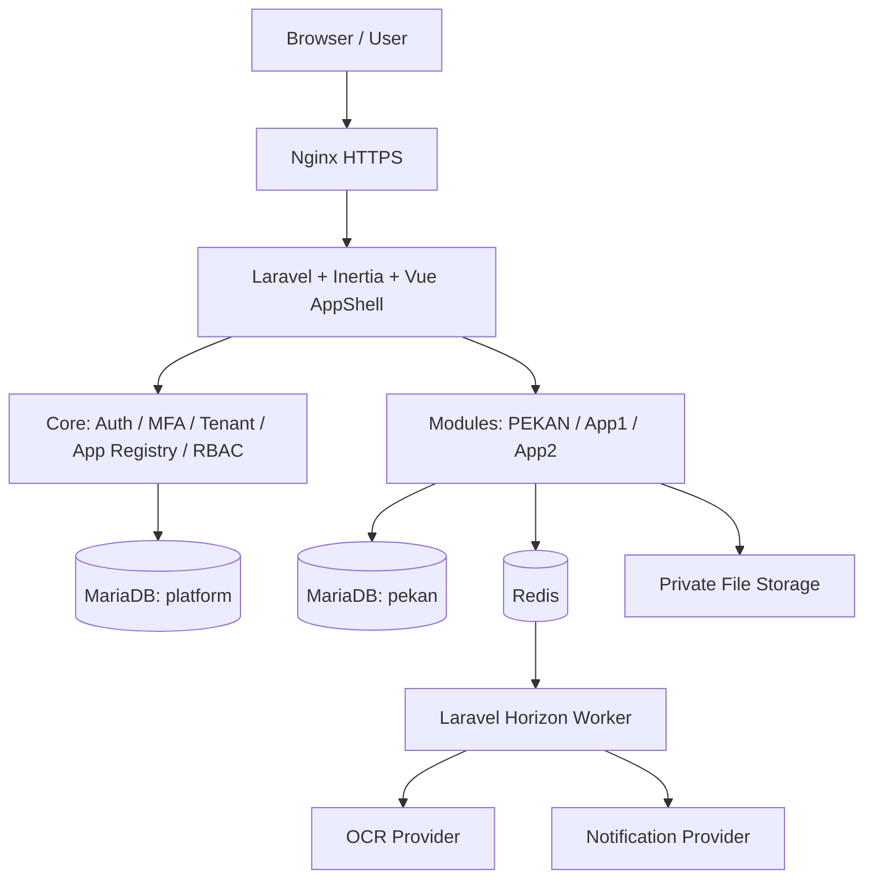

# RUDIMAH  :  Target Architecture & Engineering Rules

## 1. Ringkasan
**RUDIMAH = Ruang Digital Manajemen Harian.** Satu platform modular multi-tenant untuk mengakses PEKAN (aplikasi lama yang direbuild) dan webapp lain. Arsitektur awal **Laravel Modular Monolith**; seluruh UI dan UI behavior memakai shared design system. Belum ada bukti source code PEKAN pada paket ini; klasifikasikan semua detil legacy sebagai **belum diverifikasi**.

## 2. Tech stack target
- Laravel 13, PHP ≥8.3, versi final disesuaikan paket kompatibel dan didokumentasikan.
- Vue 3 Composition API + TypeScript + Inertia 3 + Vite + Tailwind 4.
- RUDIMAH shared components (dapat memakai Reka UI/shadcn-vue hanya sebagai primitives).
- MariaDB InnoDB untuk relasional; Redis (cache, queue, optional session); Laravel Horizon & Scheduler.
- Nginx + PHP-FPM di Docker Compose; storage privat local/S3-compatible; AI OCR provider via adapter.
- Laravel Fortify untuk account auth, TOTP/Passkeys sesuai dukungan terverifikasi; Spatie Permission bila cocok; tenancy package dipilih setelah kompatibilitas dan threat model.

## 3. Diagram logical


## 4. Kontrak aplikasi
- Core owns: identitas, sesi, tenant membership, policy, entitlements, app registry, app shell, security logs, notifications.
- Module owns: domain rules, data model, forms, reports, actions, tenant-scoped records.
- Tidak boleh modul mengubah tabel identity/tenant secara langsung tanpa Core service contract.
- Gunakan service interfaces, events, queues untuk komunikasi lintas modul yang memang diperlukan.
- App1/App2 hanyalah skeleton aman sampai requirements nyata tersedia; **jangan mengarang fitur**.
- Semua menu modul memakai manifest: `key`, `slug`, `name`, `icon`, `route`, `capabilities`, `policy`, `enabled`, `navigation`.
- Menu terlihat hanya bila user memenuhi tenant membership + app entitlement + permission. Backend mengulang seluruh pemeriksaan.

## 5. Tenant resolution
1. Laravel auth memeriksa sesi + MFA policy.
2. Resolver mengambil tenant dari route berbentuk `/t/{tenantSlug}/apps/{appSlug}` atau tenant aktif yang tervalidasi.
3. Resolve tenant dari DB; cek aktif/suspended.
4. Verifikasi membership pengguna dan tenant policy.
5. Verifikasi app enabled untuk tenant dan permission pengguna.
6. Scoped service dan repository membaca data tenant saja.
7. Clear tenant context pada akhir request/job untuk mencegah context bleeding.

Kontrol tidak hanya global scopes: Policies, explicit ownership, composite unique constraints, tenant-qualified query builders, tenant-aware validation, cache/storage/queue scoping, dan negative tests Tenant A vs B.

## 6. Database target
- `platform_db`: user, tenants, membership, app registry, app grants, role permissions, MFA config, sessions, audit logs, security policies.
- `pekan_db`: **berdasarkan schema PEKAN existing setelah reverse engineering**; tambahan baru seperti receipts/ocr jobs hanya bila diperlukan; `tenant_id` pada data milik tenant.
- Dua database boleh di server MariaDB yang sama. Nama, host, port, user, password sepenuhnya ditentukan saat instalasi. Jangan mengandalkan cross-database foreign key; referensial lintas domain melalui layanan dan pemeriksaan integritas.
- `tenant_id` multi-tenant shared DB adalah default fase awal; tenant-dedicated DB adalah opsi masa depan dengan migrasi eksplisit, bukan switch otomatis.
- Gunakan `DECIMAL(p,s)` atau integer minor units untuk uang; aturan presisi/perpajakan/rounding harus mengikuti PEKAN existing. Gunakan DB transactions, idempotency keys, appropriate indexes.

## 7. UI application shell
- Header global RUDIMAH: brand, tenant switcher, app launcher, notif, akun/security.
- App area: breadcrumb, title, actions, module sidebar; consistent loading/empty/error states.
- Menu dan shell tunggal. PEKAN legacy visual parity di dalam content region memakai compatibility adapter; migration visual ke standar baru butuh approval.
- Design tokens, shared components, locale id-ID, responsive dan accessibility: `docs/DESIGN_SYSTEM.md`.

## 8. OCR dataflow (fitur baru)
`Upload receipt → server validation → private tenant-scoped storage → OCR job queued → provider adapter → structured JSON validation → normalize → consistency/duplicate checks → user review & correction → atomic transaction commit`.
- Model responses untrusted, tidak boleh memberi instruksi eksekusi.
- OCR tidak langsung mengesahkan transaksi.
- Provider timeout, idempotency, retry/backoff, cost limit, file retention, tenant-aware jobs, provenance, observability.
- File dan raw JSON bersifat sensitif; jangan simpan file di public webroot.

## 9. Deployment topology
Single host Docker Compose: `nginx`, `app` (PHP-FPM), `horizon`, `scheduler`, `mariadb` (internal optional jika eksternal), `redis` (internal optional), `certbot`/ACME management. Public ports Nginx only. Persistent data MariaDB, receipt storage, certs, backups, config. Tidak mengklaim zero downtime single-server tanpa mekanisme pendukung. Tidak ada Docker socket di app.

## 10. Lifecycle scripts
- `installer.sh`: wizard interaktif + noninteractive; input database internal/eksternal, nama DB dan user independen, host, password tersembunyi, domain, port publik, SSL, resource, optional integrations. Generate secrets; validate; idempotent; no hardcoded credential.
- `update.sh`: lock, snapshot/backup terverifikasi, compatibility checks, safe migrations, controlled rollout, health check, non-destructive rollback guidance.
- `uninstall.sh`: stop/remove project containers only; keep data by default; explicit confirmed purge.
- `backup.sh`, `restore.sh`, `status.sh`, `reconfigure.sh`, `renew-ssl.sh`: operasional aman dan terdokumentasi.
- Let's Encrypt HTTP-01 tetap membutuhkan external port 80 meski host-port internal bisa custom; bila tidak, DNS-01 atau external reverse proxy.

## 11. Security
Central auth + MFA, platform/tenant/app/resource authorization, threat model dan controls di `docs/SECURITY.md`.

## 12. Test strategy & release gates
Pest/PHPUnit (unit/feature/security), Playwright (E2E & visual regression), Larastan/PHPStan, Pint, typecheck TS, ESLint, SAST, secret scanning, dependency audit, container scanner. Separate smoke tests prod-like and stage restore dry-run. Release gates: legacy feature parity, tenant isolation negative test, MFA bypass prevention, payment/finance precision, OCR review, no open critical/high risk without accepted mitigation.

## 13. Source tree target
```text
app/Core/{Identity,Tenancy,Authorization,Applications,MFA,Audit}
app/Modules/Pekan/{Http,Models,Services,Actions,Jobs,Policies,Database,Routes}
app/Modules/App1/
app/Modules/App2/
resources/js/{design-system,layouts,modules,composables,types}
resources/css/{tokens.css,app.css}
database/{migrations,seeders,factories}
routes/
tests/{Feature,Unit,Browser,visual}
docker/{nginx,php,mariadb,redis}
docs/
installer.sh update.sh uninstall.sh backup.sh restore.sh status.sh reconfigure.sh
```
Adapt to Laravel conventions, do not create empty abstractions without value.

## 14. ADRs required
- ADR-001: Modular monolith vs independent apps.
- ADR-002: MariaDB shared tenant model.
- ADR-003: Authentication/MFA approach and assurance levels.
- ADR-004: PEKAN legacy visual parity vs RUDIMAH shared shell.
- ADR-005: OCR provider, retention & consent.
- ADR-006: Secret management & backup key custody.
- ADR-007: External application extraction / SSO transition.

## Referensi
https://laravel.com/framework/docs/deployment
https://laravel.com/starter-kits
https://spatie.be/docs/laravel-multitenancy/v4/introduction
https://cheatsheetseries.owasp.org/cheatsheets/Multi_Tenant_Security_Cheat_Sheet.html
