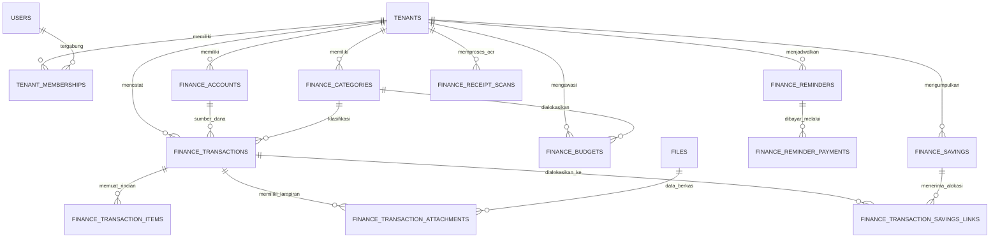

# Diagram Hubungan Entitas Database Legacy PEKAN

Dokumen ini mendeskripsikan skema relasional 45 tabel yang diverifikasi dari migrasi database `pekan` (commit `2c8a1d5`) serta pemetaannya ke basis data MariaDB InnoDB untuk platform RUDIMAH.

## 1. Pembagian Wilayah Basis Data
Pada arsitektur target RUDIMAH, data dipisahkan secara logis ke dalam dua basis data yang dapat berada dalam satu server MariaDB:
1. `platform_db`: Mengelola entitas identitas pengguna, otentikasi MFA, keanggotaan tenant, kontrol akses peran, katalog aplikasi, dan berkas umum.
2. `pekan_db`: Mengelola entitas modul keuangan PEKAN dengan label `tenant_id` pada setiap tabel transaksional.

## 2. Diagram Mermaid Relasi Inti

## 3. Spesifikasi Tabel Inti Modul Keuangan

### 3.1 `finance_accounts`
* `id`: VARCHAR(36) Kunci Utama (UUID)
* `tenant_id`: VARCHAR(36) Kunci Asing ke tenants
* `name`: VARCHAR(150) Nama rekening atau dompet
* `account_type`: VARCHAR(50) Jenis akun (cash, bank, ewallet, investment)
* `currency`: CHAR(3) Kode mata uang (default IDR)
* `opening_balance_minor`: BIGINT Saldo awal dalam satuan minor (rupiah penuh)
* `current_balance_minor`: BIGINT Saldo terkini hasil rekonsiliasi mutasi
* `is_active`: BOOLEAN Status aktif
* `created_by`: VARCHAR(36) Pengguna pembuat
* `created_at`, `updated_at`: TIMESTAMP

### 3.2 `finance_categories`
* `id`: VARCHAR(36) Kunci Utama (UUID)
* `tenant_id`: VARCHAR(36) Kunci Asing ke tenants
* `name`: VARCHAR(150) Nama kategori
* `category_type`: VARCHAR(20) Jenis pos (income, expense, atau savings)
* `parent_id`: VARCHAR(36) Nullable, relasi hirarki ke kategori induk
* `icon`: VARCHAR(50) Pengenal ikon netral
* `color`: VARCHAR(20) Pengenal token warna
* `is_active`: BOOLEAN Status aktif
* `created_by`: VARCHAR(36) Pengguna pembuat
* `created_at`, `updated_at`: TIMESTAMP

### 3.3 `finance_transactions`
* `id`: VARCHAR(36) Kunci Utama (UUID)
* `tenant_id`: VARCHAR(36) Kunci Asing ke tenants
* `account_id`: VARCHAR(36) Kunci Asing ke finance_accounts
* `category_id`: VARCHAR(36) Nullable, Kunci Asing ke finance_categories
* `type`: VARCHAR(20) Jenis mutasi (income, expense, transfer, savings)
* `amount_minor`: BIGINT Nilai mutasi total dalam satuan minor
* `currency`: CHAR(3) Mata uang transaksi (IDR)
* `transaction_date`: DATE Tanggal aktual transaksi
* `input_date`: DATE Tanggal pencatatan di sistem
* `description`: TEXT Keterangan umum transaksi
* `merchant_name`: VARCHAR(200) Nama tempat transaksi atau toko
* `receipt_number`: VARCHAR(100) Nomor struk atau nomor faktur
* `payment_method`: VARCHAR(50) Metode pembayaran
* `subtotal_minor`: BIGINT Nilai subtotal sebelum pajak dan potongan
* `tax_minor`: BIGINT Nilai pajak
* `service_charge_minor`: BIGINT Nilai biaya layanan
* `receipt_discount_minor`: BIGINT Nilai potongan harga struk
* `notes`: TEXT Catatan internal pengguna
* `created_by`, `updated_by`: VARCHAR(36) Pengguna terkait
* `deleted_at`: TIMESTAMP Nullable untuk mekanisme soft delete
* `created_at`, `updated_at`: TIMESTAMP

### 3.4 `finance_transaction_items`
* `id`: VARCHAR(36) Kunci Utama (UUID)
* `tenant_id`: VARCHAR(36) Kunci Asing ke tenants
* `transaction_id`: VARCHAR(36) Kunci Asing ke finance_transactions
* `item_name`: VARCHAR(255) Nama barang atau rincian item
* `quantity`: DECIMAL(12,4) Jumlah kuantitas barang
* `price_minor`: BIGINT Harga satuan dalam satuan minor
* `discount_minor`: BIGINT Potongan harga per item dalam satuan minor
* `total_minor`: BIGINT Total bersih baris item dalam satuan minor
* `notes`: TEXT Catatan per baris
* `created_by`, `updated_by`: VARCHAR(36)
* `created_at`, `updated_at`: TIMESTAMP

### 3.5 `finance_budgets`
* `id`: VARCHAR(36) Kunci Utama (UUID)
* `ida`: VARCHAR(50) Kode alfanumerik anggaran
* `tenant_id`: VARCHAR(36) Kunci Asing ke tenants
* `name`: VARCHAR(150) Nama alokasi anggaran
* `category_id`: VARCHAR(36) Nullable, Kunci Asing ke finance_categories
* `amount_limit_minor`: BIGINT Batas maksimum pengeluaran
* `spent_amount_minor`: BIGINT Realisasi pengeluaran berjalan
* `currency`: CHAR(3) Mata uang (IDR)
* `period`: VARCHAR(20) Periode pengawasan (weekly, monthly, yearly)
* `start_date`: DATE Tanggal mulai periode
* `end_date`: DATE Nullable, tanggal berakhir periode
* `alert_threshold_pct`: INT Persentase peringatan dini (default 80)
* `status`: VARCHAR(20) Status anggaran (active, exceeded, archived)
* `created_by`, `updated_by`: VARCHAR(36)
* `created_at`, `updated_at`: TIMESTAMP

### 3.6 `finance_savings`
* `id`: VARCHAR(36) Kunci Utama (UUID)
* `sid`: VARCHAR(50) Kode alfanumerik pos tabungan
* `tenant_id`: VARCHAR(36) Kunci Asing ke tenants
* `name`: VARCHAR(150) Nama tujuan tabungan
* `target_amount_minor`: BIGINT Target dana yang ingin dicapai
* `current_amount_minor`: BIGINT Akumulasi dana terkumpul
* `currency`: CHAR(3) Mata uang (IDR)
* `start_date`: DATE Tanggal mulai menabung
* `target_date`: DATE Nullable, tenggat waktu impian
* `notes`: TEXT Catatan strategi tabungan
* `status`: VARCHAR(20) Status pos (active, completed, cancelled)
* `created_by`, `updated_by`: VARCHAR(36)
* `created_at`, `updated_at`: TIMESTAMP

### 3.7 `finance_reminders` & `finance_reminder_payments`
* `finance_reminders`: Mengelola kewajiban berulang dengan `title`, `due_date`, `repeat_interval`, `total_tenor`, `current_tenor`, dan `status`.
* `finance_reminder_payments`: Mengelola riwayat pelunasan dengan `paid_at`, `amount_minor`, `status`, dan referensi `proof_image_url`.

### 3.8 `finance_receipt_scans`
* `id`: VARCHAR(36) Kunci Utama (UUID)
* `tenant_id`: VARCHAR(36) Kunci Asing ke tenants
* `provider_code`: VARCHAR(50) Kode provider AI OCR
* `model_name`: VARCHAR(100) Model vision yang digunakan
* `status`: VARCHAR(30) Status pemrosesan (uploaded, processing, verified, failed)
* `original_filename`: VARCHAR(255) Nama file asli
* `mime_type`: VARCHAR(100) Tipe berkas
* `extracted_json`: JSON Hasil ekstraksi terstruktur
* `error_message`: TEXT Nullable, catatan bila gagal
* `created_by`: VARCHAR(36) Pengguna yang mengunggah
* `created_at`, `updated_at`: TIMESTAMP
